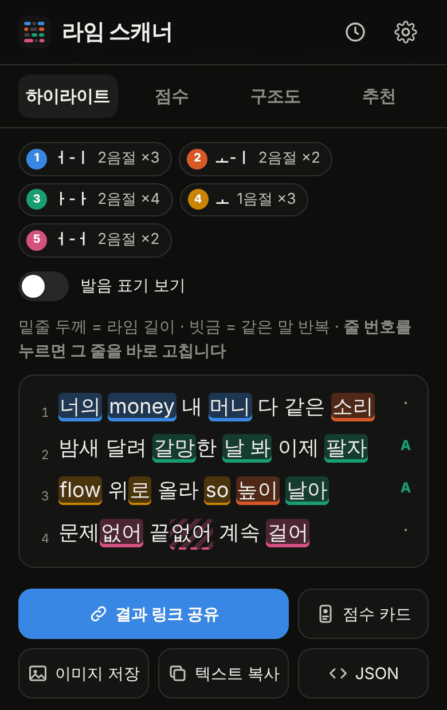
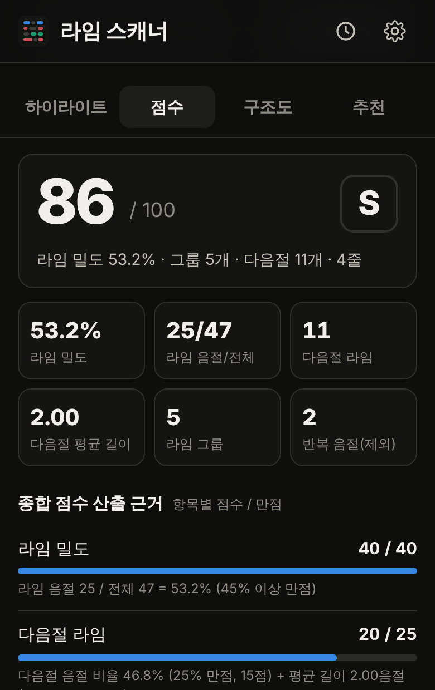
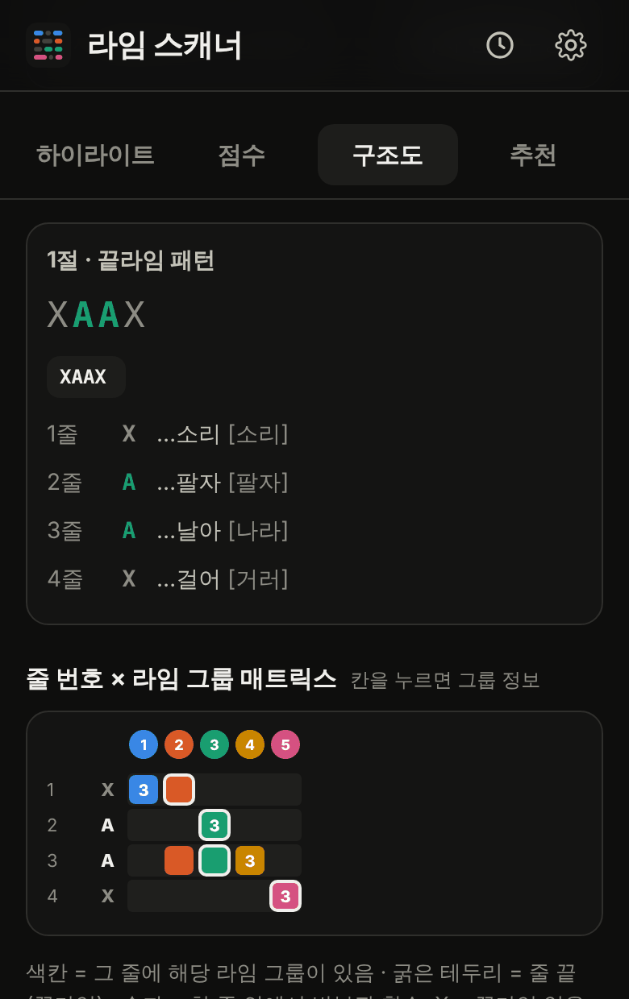

# 라임 스캐너

[](https://github.com/choihs-ai/rhyme/actions/workflows/test.yml)

한국어와 영어가 섞인 랩 가사를 붙여 넣으면 라임을 찾아 색으로 표시하고, 점수와 끝라임 구조를 계산하고, 라임이 맞는 단어를 추천하는 웹앱입니다. 서버 없이 브라우저에서만 돌아가고, 한 번 열어 두면 오프라인에서도 실행됩니다.

**데모: https://choihs-ai.github.io/rhyme/** (설치·가입 없음, 첫 화면에 예시 가사 분석이 바로 보입니다)

<p>
  
  
  
</p>

| | |
|---|---|
| 만든 사람 | 1인 개발 (기획, 분석 엔진, 화면, 테스트, 배포) |
| 기술 | HTML, CSS, JavaScript(ES 모듈). 프레임워크와 빌드 도구 없음. 런타임 의존 패키지 0개 |
| 규모 | 분석·화면 코드 21개 모듈 약 3,200줄, 한국어 38,566단어와 영어 20,000단어 사전 |
| 배포 | GitHub Pages, PWA(홈 화면 추가, 오프라인 실행) |
| 검증 | 직접 쓴 가사 89편의 정답 세트로 자동 채점, 푸시할 때마다 GitHub Actions 실행 |

## 무엇을 하는 도구인가

랩 가사를 쓸 때 라임이 어디에 얼마나 있는지는 귀로 확인합니다. 이 도구는 그 확인을 눈으로 할 수 있게 해 줍니다.

- **하이라이트**: 같은 라임끼리 같은 색으로 칠합니다. 밑줄 두께가 라임 길이(음절 수)이고, 같은 말을 되풀이한 곳은 빗금으로 구분합니다.
- **점수**: 라임 밀도, 다음절 라임, 끝라임, 다양성, 반복 회피를 합쳐 100점으로 매기고 항목별 계산 근거를 보여 줍니다.
- **구조도**: 줄 끝 라임 패턴(AABB, ABAB, ABBA)과 줄별 라임 그룹 표를 보여 줍니다.
- **추천**: 단어를 넣으면 모음 패턴이 맞는 한국어·영어 단어를 음절 수별로 찾아 줍니다. `머니`를 넣으면 `honey`, `주머니`가 같이 나옵니다.

찾는 라임은 끝라임(각운), 다음절 라임, 한 줄 안의 내부 라임, 받침은 다르고 모음만 맞는 모음 라임, 한국어와 영어가 서로 맞는 한영 교차 라임입니다.

## 어려웠던 문제와 해결

### 1. 글자와 소리가 다르다

`같이`는 `[가치]`로, `없어`는 `[업써]`로, `국물`은 `[궁물]`로 읽습니다. 글자대로 비교하면 `같이`와 `가치`는 받침이 달라서 다른 소리가 됩니다. 그래서 모든 가사를 먼저 실제 발음으로 바꾼 뒤 비교합니다.

한글을 초성·중성·종성으로 나누고 표준 발음법의 규칙(연음, 겹받침, 7종성, 비음화, 유음화, 경음화, 격음화, 구개음화)을 순서대로 적용합니다. 숫자와 기호도 읽습니다(`24살`은 스물네살, `1999년`은 천구백구십구년, `100%`는 백퍼센트). 규칙 73개에 대한 테스트가 `tests/pronounce.test.mjs`에 있습니다.

### 2. 영어와 한국어를 같은 잣대로 비교하기

`money`와 `머니`가 라임이라는 것을 알려면 두 언어를 같은 표기로 옮겨야 합니다. 영어 단어는 CMU 발음 사전의 음소열(ARPAbet)을 한글 음절로 바꿉니다. `money`의 음소 `M AH1 N IY0`는 `머니`가 됩니다. 사전에 없는 단어는 접미사를 떼어 보고(`flexin`은 `flex`+`in`), 그래도 없으면 철자 규칙으로 읽습니다. 랩에서 자주 쓰는 표기(`gonna`, `skrrt`, `runnin'`)는 예외 사전 943개를 직접 만들었습니다.

한글로 옮기면 두 가지가 어긋납니다.

**없는 모음이 생긴다.** 한글은 자음만 따로 쓸 수 없어서 `street`이 `스트릿` 3음절이 됩니다. 실제로는 1음절이라 `beat`와 맞는 단어인데 음절 수가 달라 놓쳤습니다. 끼워 넣은 `ㅡ` 음절에 표시를 해 두고(삽입모음), 라임 구간이 삽입모음으로 시작하거나 끝나지 못하게 했습니다. 화면에 칠할 때만 단어 전체로 넓힙니다.

**같은 소리가 다른 음절 수로 옮겨진다.** `real`은 `리얼` 2음절, `feel`은 `필` 1음절로 옮겨져서 한글로는 맞지 않습니다. 영어 화자에게는 완전한 라임입니다. 그래서 영어 단어마다 "마지막 강세 모음부터 끝까지"의 음소열(운 꼬리)을 사전에 함께 넣었습니다. `real`과 `feel`은 둘 다 `IY.L`이라서, 한글 표기가 달라도 같은 운으로 판정합니다. 반대로 한글로는 비슷해 보여도 영어 모음 부류가 다르면 점수를 깎습니다.

| 가사 | 이전 | 현재 |
|---|---|---|
| I keep it **real** / You know how I **feel** | 못 찾음 | real / feel |
| Running through the **street** / Moving to the **beat** | 엉뚱한 쌍(Running / the beat) | street / beat |
| 그려 보는 **dream** / 낡은 **그림** | 못 찾음 | dream / (그)림 |
| 시작되는 **show** / 앞으로 **go** / 절대**로** | 엉뚱한 쌍(는 show / 으로) | show / go / 로 |

### 3. 한국어는 우연히 맞는 모음이 너무 많다

한국어 단모음은 열 개 안팎이고, 문장은 `-는`, `-고`, `-다` 같은 조사와 어미로 끝납니다. 모음이 같은 음절을 다 라임으로 치면 일기도 랩처럼 칠해집니다. 반대로 조건을 조이면 진짜 라임을 놓칩니다. 이 균형이 엔진에서 가장 오래 걸린 부분입니다.

- **조사와 어미는 근거에서 뺀다.** `먹는다 / 간다`의 `다`는 문법이 맞은 것이라 라임의 근거로 세지 않습니다. 다만 `종이`의 `이`처럼 사전에 있는 낱말의 끝 음절은 조사로 보지 않습니다(38,566단어 사전으로 확인).
- **받침은 줄 끝에서만 눈감아 준다.** 줄 끝은 길게 끌어 발음해서 `방 / 밤 / 난`이 라임으로 들리지만, 줄 중간에서 받침까지 다른 한 음절은 대부분 우연입니다.
- **같은 말 반복은 라임이 아니다.** `문제없어 / 끝없어`의 `없어`는 같은 단어라서 빗금으로 따로 표시하고 점수에서 뺍니다.
- **반모음 차이는 거의 같은 소리로 본다.** `봐 / 가`, `사상 / 환상`은 래퍼들이 실제로 쓰는 라임입니다. 처음 설계에서 이중모음과 단모음의 유사도를 0.6으로 두었던 것을 0.9로 올렸습니다.
- **대조군을 둔다.** 라임을 의도하지 않은 산문(일기, 대화, 설명문, 영어 산문)을 같이 채점해서, 재현율을 올린 수정이 산문에서 오탐을 늘리면 바로 드러나게 했습니다.

### 4. 고친 것이 정말 나아진 것인지 확인하기

판정 규칙 하나를 고치면 다른 가사가 깨지는 일이 반복됐습니다. 그래서 규칙을 손대기 전에 채점 기준부터 만들었습니다.

1. **개발용 정답 세트 65편**을 직접 썼습니다. 가사마다 "이 조각들은 같은 라임", "이 둘은 묶이면 안 됨", "이건 반복", "끝라임 구조는 ABAB"를 적었습니다. 판단이 갈리는 약한 라임은 정답에 넣지 않았습니다.
2. **검증용 세트 24편**을 따로 썼습니다. 엔진 결과를 보기 전에 작성했고, 개발용 세트로 규칙을 다 고친 뒤에 처음 돌렸습니다. 개발용 세트에만 맞춘 규칙인지 확인하기 위해서입니다.
3. 채점기가 이전 커밋의 엔진과 현재 엔진을 같은 세트로 채점해 나란히 보여 줍니다(`npm run compare`).

## 정확도 개선 결과

v1.3.2(커밋 `8edb4da`)와 현재를 같은 정답 세트로 채점한 결과입니다. `npm run compare`로 다시 만들 수 있습니다.

| 개발용 65편 | 이전 | 현재 |
|---|---|---|
| 통과한 가사 | 44 / 65 | 65 / 65 |
| 라임 쌍 재현율 | 84 / 119 (71%) | 119 / 119 (100%) |
| 끝라임 구조 일치 | 41 / 46 | 46 / 46 |
| 산문에서 잘못 칠한 음절 | 44 / 461 (9.5%) | 34 / 461 (7.4%) |

| 검증용 24편 | 이전 | 처음 돌렸을 때 | 현재 |
|---|---|---|---|
| 라임 쌍 재현율 | 27 / 39 (69%) | 37 / 39 (95%) | 39 / 39 (100%) |
| 산문에서 잘못 칠한 음절 | 8 / 144 (5.6%) | 15 / 144 (10.4%) | 6 / 144 (4.2%) |

분류별로는 내부 라임(1/4 → 4/4), 영어(7/12 → 12/12), 모음 라임(3/7 → 7/7)이 가장 많이 나아졌습니다.

이 숫자를 읽을 때 알아 둘 점이 있습니다.

- 개발용 100%는 "알고 있던 실패를 다 고쳤다"는 뜻입니다. 이 세트를 보면서 규칙을 고쳤으니 일반 정확도로 읽으면 안 됩니다.
- 처음 보는 가사에 대한 추정치로는 검증용의 **첫 실행 값(재현율 95%, 산문 오탐 10.4%)** 이 더 정직합니다. 첫 실행에서 드러난 문제(줄이 다른 내부 라임 `사랑 / 자랑`을 놓침, 산문에서 `더`, `것` 같은 기능어끼리 묶임)를 고친 뒤로는 검증용 세트도 본 적 없는 가사가 아닙니다.
- 정답은 한 사람(만든 사람)이 정했습니다. 라임은 듣는 사람마다 기준이 달라서, 다른 사람이 채점하면 숫자가 달라질 수 있습니다.

남은 한계와 그동안 내린 결정은 [NOTES.md](NOTES.md)에 적었습니다.

## 기술 구조

```
가사 ──▶ 발음 변환 ──▶ 라임 판정 ──▶ 화면
        pronounce.js    rhyme.js      render.js
```

분석 로직(`js/pron`, `js/rhyme`)은 DOM을 건드리지 않는 함수라서 Node에서 그대로 테스트합니다. 화면 코드는 분석 결과 객체만 받아 그립니다.

```
js/pronounce.js         가사를 줄·단어·음절로 나누고 발음을 붙인다
js/pron/hangul.js         자모 분해·합성, 표준 발음 규칙
js/pron/numbers.js        숫자·기호 읽기
js/pron/english.js        영어 → 한글 (발음 사전, 접미사 분해, 철자 규칙, 운 꼬리)

js/rhyme.js             아래 단계를 차례로 부른다
js/rhyme/similarity.js    모음·받침 유사도
js/rhyme/endings.js       조사·어미·기능어 표시
js/rhyme/units.js         음절마다 단어·줄 경계 정보를 붙이고 구간 비교 함수를 만든다
js/rhyme/candidates.js    가까운 줄끼리 구간을 견주어 후보 쌍을 모은다
js/rhyme/groups.js        후보를 그룹으로 묶고, 반복을 표시하고, 우연한 일치를 거른다
js/rhyme/result.js        화면·내보내기용 결과로 정리한다
js/rhyme/scheme.js        끝라임 구조
js/rhyme/score.js         100점 점수와 근거

js/render.js            결과 화면 HTML
js/ui/                  색·표시 규칙, 이미지 생성(canvas), DOM 도우미
js/recommend.js         라임 단어 추천
js/export.js            텍스트·JSON 내보내기
js/share.js             결과 링크(주소에 가사와 설정을 압축해 담는다)
js/app.js               상태, 이벤트, 저장, 서비스 워커 등록
sw.js                   오프라인 캐시
data/                   사전 (빌드 스크립트는 tools/)
tests/                  테스트
```

**라임 판정 순서**

1. 음절마다 모음, 받침, 단어·줄에서의 위치, 조사 여부를 붙입니다.
2. 가까운 줄의 구간 쌍을 견주어 유사도를 냅니다. 음절 점수는 모음 0.75, 받침 0.25의 비중이고, 긴 라임일수록 먼 줄까지 찾습니다.
3. 점수가 높은 쌍부터 그룹을 만듭니다. 긴 라임이 먼저 자리를 잡고, 짧은 라임은 남은 음절에서만 잡힙니다.
4. 같은 말 반복을 표시합니다.
5. 근거가 약한 그룹을 버립니다. 줄 끝이 둘 이상 맞거나, 3음절 이상이거나, 단어 끝이 맞으면서 가까이 있는 것만 남깁니다.

**설계에서 고른 것**

- **빌드 도구 없음.** 저장소에 푸시한 파일이 그대로 배포본입니다. 모듈이 21개라 번들러 없이도 첫 로딩에 문제가 없고, 서비스 워커가 한 번에 캐시합니다.
- **서버 없음.** 분석을 전부 브라우저에서 합니다. 가사가 기기 밖으로 나가지 않고, 운영 비용이 없습니다. 260줄 가사를 0.1초 안에 분석합니다.
- **사전은 미리 계산해서 싣는다.** 발음 사전 원본(13만 단어)을 다 싣지 않고, 빈도 상위 20,000단어의 한글 표기와 운 꼬리를 빌드 때 계산해 둡니다. 두 사전을 합쳐 1.5MB, gzip 전송 기준 0.6MB입니다.

## 사용법

1. https://choihs-ai.github.io/rhyme/ 을 엽니다. 아이폰에서는 사파리 공유 버튼의 **홈 화면에 추가**로 앱처럼 쓸 수 있습니다.
2. 가사를 붙여 넣고 **분석하기**를 누릅니다. 빈 줄은 벌스 구분이고, `[Verse 1]`, `(Hook)` 같은 머리말 줄은 분석에서 뺍니다.
3. 결과에서 할 수 있는 것
   - 색 칩을 누르면 그 라임만 강조합니다.
   - 가사를 누르면 발음 표기와 모음 패턴이 나오고, 틀린 발음은 직접 고칠 수 있습니다(기기에 저장).
   - 줄 번호를 누르면 그 줄만 고쳐서 바로 다시 분석합니다.
   - 잘못 잡힌 라임은 **빼기**(조각 하나)나 **라임 아님**(그룹 전체)으로 제외합니다.
4. 아래 버튼으로 결과 링크 공유, 점수 카드, 이미지 저장, 텍스트 복사, JSON 내보내기를 합니다.

옵션: 모음만 같아도 라임으로 볼지, 최소 라임 음절 수(1~4), 판정 민감도.

**점수 기준 (100점)**

| 항목 | 만점 | 계산 |
|---|---|---|
| 라임 밀도 | 40 | 라임 음절 ÷ 전체 음절 (45% 이상이면 만점) |
| 다음절 라임 | 25 | 다음절 음절 비율(25%면 15점) + 평균 길이(3음절이면 10점) |
| 끝라임 | 15 | 끝라임이 맞는 줄의 비율 |
| 다양성 | 10 | 서로 다른 모음 패턴 수 |
| 반복 회피 | 10 | 같은 말 반복이 많을수록 감점 |

등급은 S 85점 이상, A 70, B 55, C 40, 그 아래 D입니다. 예시로 넣어 둔 랩 벌스는 81점, 일기체 산문은 23점이 나옵니다.

## 개발

Node 22 이상이면 됩니다. 설치할 패키지가 없습니다.

```bash
npm test                 # 전체 테스트 (1~2초)
npm test -- -v           # 통과한 테스트의 출력까지 보기
npm run test:gold        # 정답 세트만. 실패한 가사는 엔진이 낸 그룹을 같이 보여 준다
npm run compare          # 이전 버전과 정확도 비교 (기본: v1.3.2)
npm run compare -- HEAD~1    # 다른 커밋과 비교
npm run test:e2e         # 브라우저 테스트 (Playwright 필요)
```

| 테스트 | 확인하는 것 |
|---|---|
| `tests/pronounce.test.mjs` | 발음 규칙 73개 (없어→업써, 24살→스물네살, flow→플로우) |
| `tests/rhyme.test.mjs` | 예시 가사의 라임 그룹과 반복 표시 |
| `tests/regress.test.mjs` | 사용자 제보로 고친 판정이 다시 깨지지 않는지 |
| `tests/gold.test.mjs` | 정답 세트 89편 전부 통과, 산문 오탐 10% 이하 |
| `tests/recommend.test.mjs` | 추천 결과에 기대한 단어가 있는지 |
| `tests/version.test.mjs` | 앱과 서비스 워커의 버전 일치, 모든 모듈이 오프라인 캐시 목록에 있는지 |
| `tests/e2e.cjs` | 아이폰 화면 크기에서 분석, 탭 이동, 내보내기, 오프라인 재시작 |

브라우저 테스트는 저장소를 임시 서버로 띄워 검사합니다. 배포된 주소를 검사하려면 `BASE=https://choihs-ai.github.io/rhyme/ npm run test:e2e`를 씁니다.

가사 한 편을 분석해 그룹을 글로 보려면 `node tests/rhyme.test.mjs 파일.txt`를 씁니다. 정답 세트에 가사를 추가하려면 `tests/gold/cases.mjs` 맨 위의 표기법을 따릅니다.

**배포**: `js/app.js`와 `sw.js`의 `VERSION`을 같이 올리고 main에 푸시합니다. 사전 파일을 바꿨다면 `sw.js`의 `DATA_VERSION`도 올립니다. 화면 맨 아래 버전 표시로 반영 여부를 확인합니다.

**사전 다시 만들기**

```bash
pip install kiwipiepy wordfreq cmudict
curl -O https://raw.githubusercontent.com/hermitdave/FrequencyWords/master/content/2018/ko/ko_50k.txt
python3 -c "import wordfreq as w; d=w.get_frequency_dict('ko'); open('wf-ko.txt','w').writelines(f'{k}\t{int(v*1e8)}\n' for k,v in sorted(d.items(),key=lambda x:-x[1])[:80000]); open('wf-en.txt','w').writelines(x+'\n' for x in w.top_n_list('en',40000))"
python3 tools/build-ko-list.py ko_50k.txt wf-ko.txt > ko-list.tsv
node tools/build-data.mjs --cmu "$(python3 -c 'import cmudict,os;print(os.path.join(os.path.dirname(cmudict.__file__),"data","cmudict.dict"))')" --en-freq wf-en.txt --ko-list ko-list.tsv
```

랩 영어 예외 사전은 `tools/data-src/en-rap.txt`(형식: `단어 한글발음`)를 고친 뒤 위 명령으로 다시 만듭니다.

## JSON 내보내기

다른 프로그램(가사 자막, 모션 그래픽)에서 쓸 수 있게 분석 결과를 JSON으로 내보냅니다.

```jsonc
{
  "format": "rhyme-scanner/v1",
  "text": "원문 전체",
  "syllables": [ { "index": 2, "text": "머", "vowel": "ㅓ", "coda": "", "onset": "ㅁ", "epenthetic": false,
                   "lang": "en", "line": 0, "word": 1, "start": 3, "end": 5, "group": 0, "member": 1, "repeat": false } ],
  "groups":    [ { "id": 0, "length": 2, "pattern": "ㅓ-ㅣ", "rime": "어이", "tags": ["multi","internal","cross"], "color": "#3987e5",
                   "members": [ { "syllables": [2,3], "start": 3, "end": 8, "text": "money", "pron": "머니", "line": 0, "lineEnd": false, "repeat": false } ] } ],
  "lines": [...], "words": [...], "scheme": [...], "scores": {...}
}
```

`start`와 `end`는 원문의 글자 위치 `[start, end)`이고, `group`은 `groups[].id`입니다(라임이 아니면 `null`).

## 데이터 출처와 라이선스

- 한국어 단어: [FrequencyWords](https://github.com/hermitdave/FrequencyWords) ko_50k (OpenSubtitles 2018, CC BY-SA 4.0), [wordfreq](https://github.com/rspeer/wordfreq) 한국어 목록 (CC BY-SA 4.0). 빌드 때 [Kiwi](https://github.com/bab2min/kiwipiepy) 형태소 분석기로 분류했습니다.
- 영어 발음: [CMU Pronouncing Dictionary](https://github.com/cmusphinx/cmudict) (BSD 2-Clause). 빈도는 wordfreq 영어 목록을 썼습니다.
- `data/`의 사전 파일은 위 CC BY-SA 4.0 데이터에서 만들었으므로 CC BY-SA 4.0으로 배포합니다.
